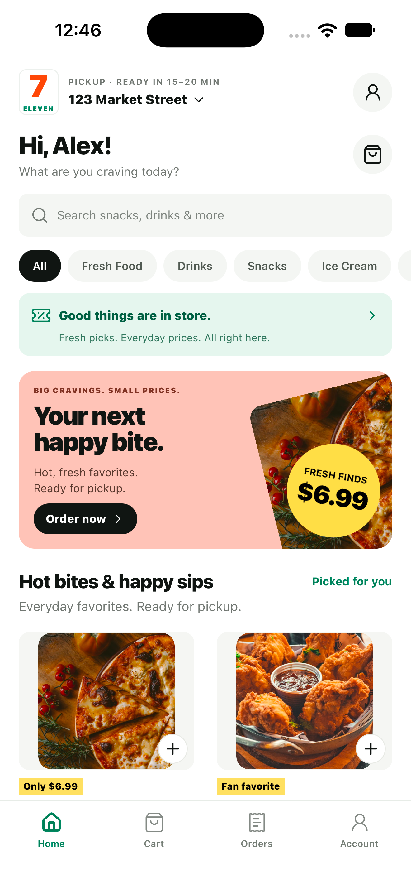
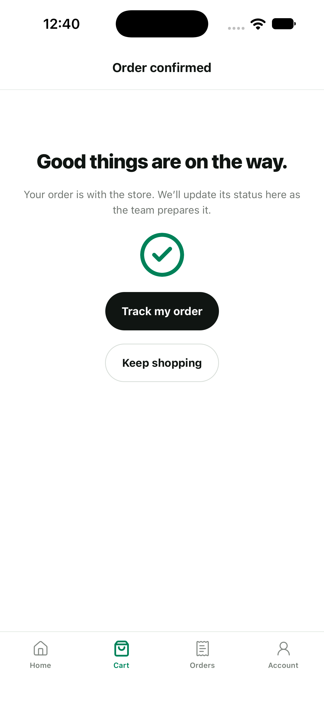
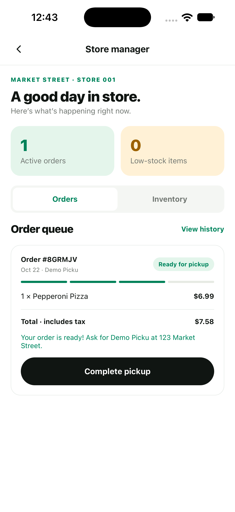

# Seven Eleven Clone

A working convenience-store MVP built with **bare React Native**, **Convex**, and **Convex Auth**. Inspired by 7-Eleven’s iOS storefront on Mobbin. Independent demo; not affiliated with 7-Eleven.

<p>
  
  
  
</p>

## What works

- **Guests:** browse and search 12 products across five categories, inspect products, keep a cart across app restarts, place a demo pickup order, track it, and cancel before preparation starts.
- **Shoppers:** register, sign in/out, edit their profile, attach this device’s guest orders to their account, and see account order history across devices.
- **Store managers:** sign in with an authorized account, view the live order queue, move orders through preparation → ready → picked up, and edit price, stock and storefront visibility.
- **Shared backend:** authoritative integer-cent pricing and tax, transactional stock deductions/restocking, idempotent checkout, and server-side ownership/role checks. Customer capabilities and checkout keys are excluded from order responses.
- **Native sessions:** authentication tokens and guest capabilities use iOS Keychain / Android Keystore via `react-native-keychain`. The cart uses AsyncStorage.

This is a single-store pickup demo. It does **not** charge cards, submit real purchases, deliver orders, send notifications, implement rewards/coupons, or support password recovery/email verification. Prices, stock, tax and pickup estimates are illustrative. Use test account details. Manager roles are granted administratively, never by public signup.

## Local development

Node 22.11+ (Node 24 LTS recommended), npm, Xcode and CocoaPods for iOS; Android Studio/JDK 17 for Android. Install Watchman on macOS (`brew install watchman`) for reliable Metro file watching. Build outputs and device evidence are excluded from the file map.

```sh
npm ci
cd ios && pod install && cd ..
npm start
# In a second terminal:
npm run ios
# or npm run android
```

`src/lib/config.ts` contains only the public development Convex URL. The hosted demo needs network access. No admin key is embedded in the app. If the shared development deployment is unavailable, provision your own backend below.

## Your own Convex backend

```sh
npx convex dev --configure new --once
node scripts/setup-auth.mjs
npx convex dev --once
npx convex run seed:run
```

Set `CONVEX_URL` in `src/lib/config.ts` to the URL printed by Convex. `setup-auth.mjs` provisions the signing key pair through stdin without logging it. **Run it once on a new deployment**; re-running rotates keys and invalidates existing access tokens. Keep `.env.local` and all credentials out of Git.

Create an account using the app, then grant manager access from the authenticated Convex CLI:

```sh
npx convex run profiles:grantManager '{"email":"your-test-manager@example.test"}'
```

This is an internal mutation: regular clients cannot call it. For local testing, `node scripts/provision-demo.mjs` creates a shopper and manager and saves credentials to ignored `artifacts/private/dev-accounts.json`. Configure its `CONVEX_URL` environment variable if using another deployment. No fixed login credentials are shipped.

## Revyl Metro hot reload

The checked-in Revyl project and iOS app belong to **Revyl Benchmarks**. Run from this repository root with an authorized CLI account:

```sh
revyl auth status
revyl config validate
revyl dev --profile development --platform ios --build --detach --json
# Next runs can reuse the latest development binary:
revyl dev --profile development --platform ios --detach --json
revyl device screenshot --out artifacts/private/screen.png
revyl dev stop --json
```

Revyl owns Metro and its relay. No Expo dependency or tunnel is used. JS/TS changes reload through Metro; changes to native dependencies, Podfile, Gradle, or native source require a rebuild. The CLI prints the active viewer URL. Add your own app IDs/project configuration if using another Revyl organization. Android native sources and a development recipe are included; device verification for this MVP targets iOS.

For automated text entry on the tested iOS session, clear the field with `revyl device clear-text`, then use `revyl device type --clear-first=false`. This avoids a last-character loss observed with the combined operation. `scripts/device-login.mjs` uses this path with privately provisioned credentials.

## Pull request proof

Revyl Proof of Changes is enabled for non-draft pull requests. The `pull-request`
profile builds a standalone iOS Release simulator app with bundled JavaScript,
then the Revyl agent exercises the changed UI and posts its verdict and evidence
to the PR. It uses a separate preview app in Revyl Benchmarks so development
builds can continue using Metro. The baseline check opens the guest storefront;
no shopper or manager credentials are published in this configuration.

The configuration is managed by `.revyl/config.yaml` on the default branch.
Validate changes with `revyl config validate` before committing them.

## Checks

```sh
npm run typecheck
npm test
node scripts/check-live.mjs # requires privately provisioned demo accounts
```

The backend suite covers manager authorization, order ownership, price calculations, stock validation, duplicate checkout, guest order claim, cancellation/restocking, and order lifecycle. See [verification](docs/VERIFICATION.md) for observed device results and [design and media](docs/REFERENCES.md) for references and image licensing.

## Repository map

- `src/screens/`: storefront, cart/checkout, account, order history, manager workspace.
- `src/components/`: shared controls and original product illustrations.
- `convex/`: schema, password auth, catalog, orders, profiles and admin-only seed/grant functions.
- `ios/`, `android/`: native React Native projects.
- `.revyl/config.yaml`: development build recipes and Revyl identifiers.

Source code is [MIT licensed](LICENSE). Third-party food photos retain the separate Unsplash license described in [REFERENCES](docs/REFERENCES.md). Mobbin screenshots and proprietary fonts are not included.
